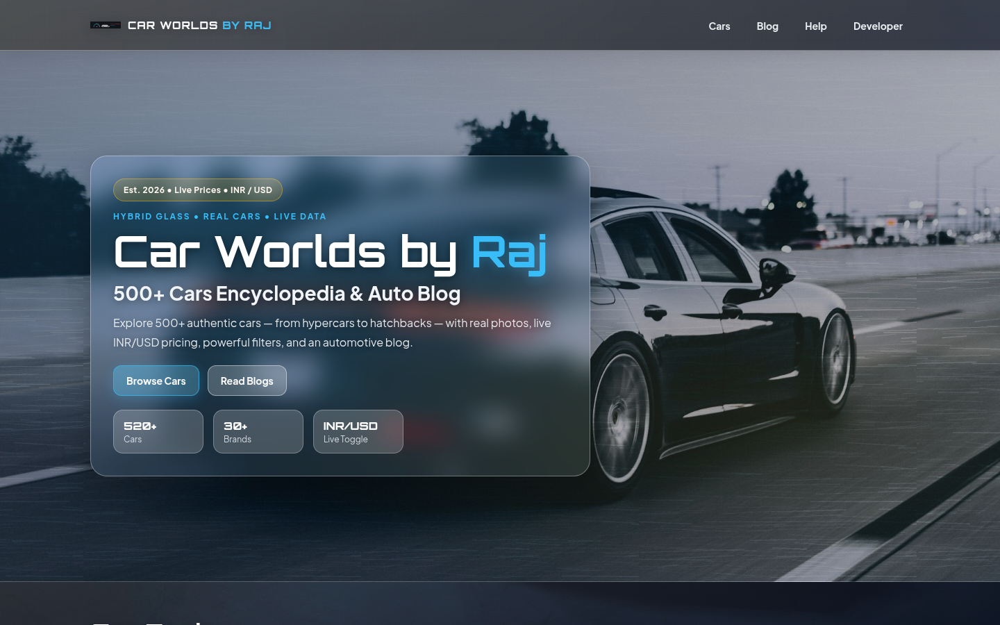
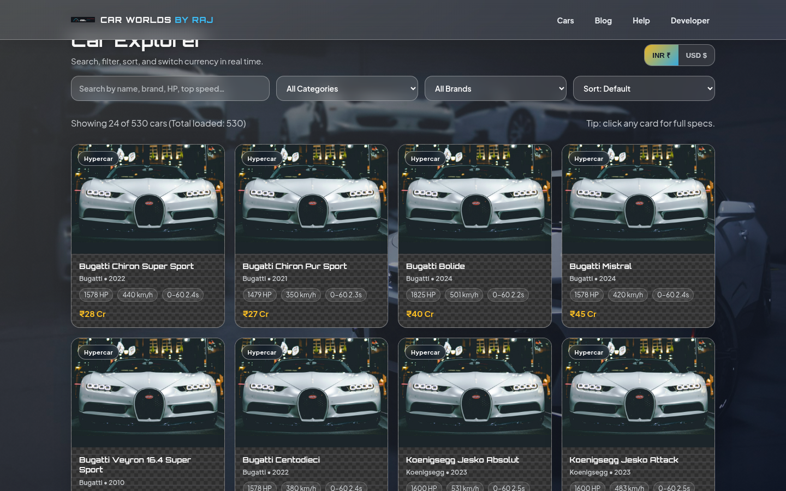
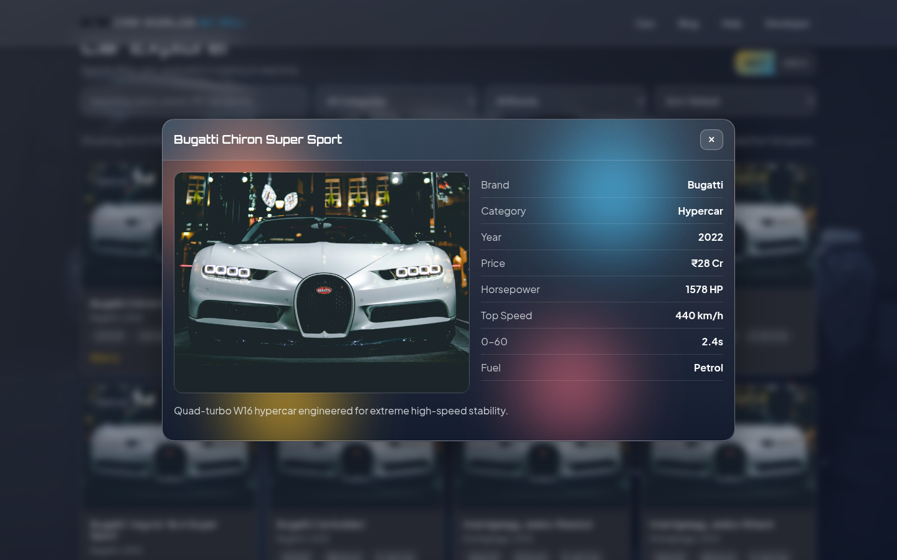
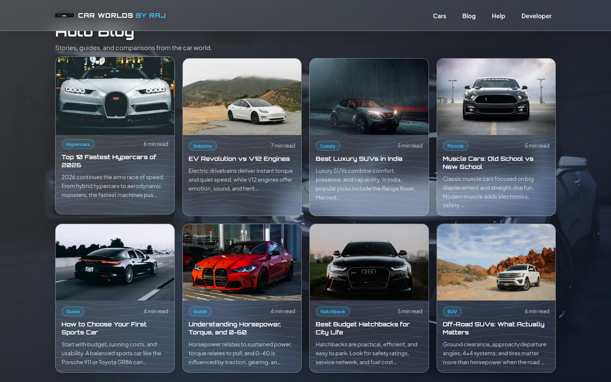
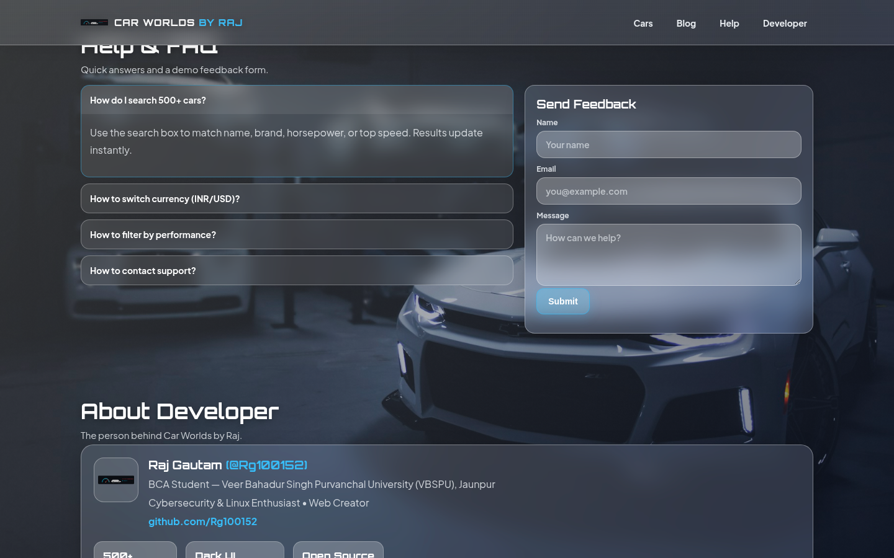
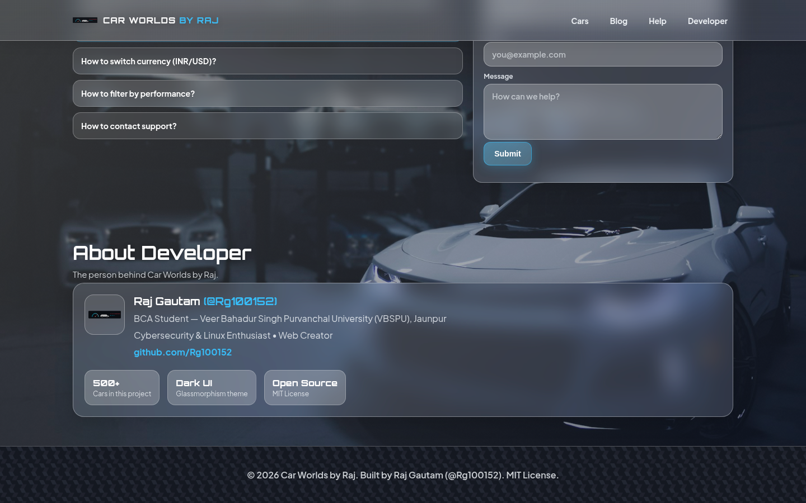

<p align="center">
  
</p>

<h1 align="center">Car Worlds by Raj</h1>

<p align="center">
  <em>500+ Cars Encyclopedia · Live INR/USD Prices · Auto Blog</em>
</p>

<p align="center">
  
  
  
  
  
</p>

<p align="center">
  <a href="https://rg100152.github.io/car-worlds-by-raj/">
    
  </a>
</p>

---

## 🏎️ Overview

**Car Worlds by Raj** is a static, high-performance car encyclopedia and auto blog featuring **530+ authentic cars** across **55+ brands**. It uses a hybrid light-dark frosted glassmorphism UI over a full-screen automotive wallpaper, with real high-resolution car photos, live INR/USD pricing, powerful search/filter/sort, and interactive modals.

## ✨ Features

- **530+ authentic car models** across 55+ brands (no fake placeholder data)
- **Hybrid Light + Dark frosted glassmorphism UI** with real background wallpaper
- **Real high-resolution car photos** on every card with reliable local fallback
- **Hero image + pattern library** (carbon fiber, speed lines, noise grain, mesh, topo, and more)
- **Live INR (₹) / USD ($) currency toggle**
- **Search, category filter, brand filter, price/HP sort**
- **Car quick-view spec modal** + **Blog reader modal**
- **Help / FAQ accordion** + demo feedback form
- **About Developer** showcase — Raj Gautam (@Rg100152)
- **Responsive design** for desktop, tablet, and mobile

## 📸 Screenshots

| Hero | Car Cards | Spec Modal |
|:---:|:---:|:---:|
|  |  |  |

| Blogs | Help & FAQ | Developer |
|:---:|:---:|:---:|
|  |  |  |

> More screenshots: `hero-with-image.png`, `patterns-visible.png`, `explorer-filters.png`, `blog-modal.png`, `footer.png`, `full-page.png`, `preloader.png` in [`assets/screenshots/`](assets/screenshots/).

## 🗂️ Folder Structure

```text
car-worlds-by-raj/
├── assets/
│   ├── images/
│   │   ├── bg-wallpaper.jpg
│   │   ├── hero.jpg
│   │   ├── logo.svg
│   │   ├── cars/               # 30+ real car photos
│   │   └── patterns/           # 10 UI pattern/texture assets
│   └── screenshots/            # README/gallery screenshots
├── css/
│   ├── animations.css
│   ├── preloader.css
│   └── style.css
├── js/
│   ├── blog.js
│   ├── cars-data.js            # 530+ authentic car entries
│   ├── filters.js
│   ├── help.js
│   ├── main.js
│   └── modal.js
├── scripts/
│   ├── build_cars_data.py
│   └── download_all_assets.py
├── index.html
├── LICENSE
└── README.md
```

## 🚀 Live Demo

**https://rg100152.github.io/car-worlds-by-raj/**

## 🛠️ Local Setup

```bash
git clone https://github.com/Rg100152/car-worlds-by-raj.git
cd car-worlds-by-raj
python3 -m http.server 8080
```

Then open `http://localhost:8080`.

## 👨‍💻 Developer

**Raj Gautam** · [@Rg100152](https://github.com/Rg100152)  
BCA Student · VBSPU Jaunpur · Cybersecurity & Linux Enthusiast

## 📄 License

MIT — see [LICENSE](LICENSE)
